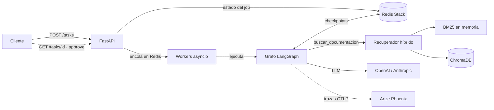
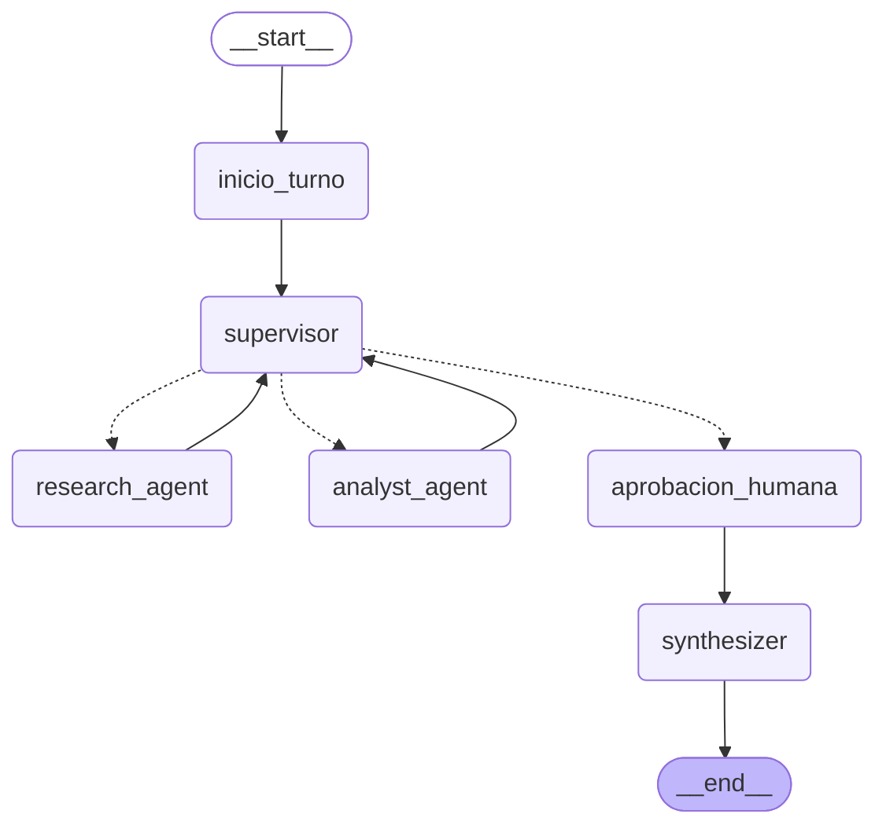

# Atlas Intelligence System

Entrega final del curso AI Engineering (Coderhouse).

Un sistema de IA de grado de producción que responde consultas técnicas complejas sobre la plataforma de pagos Atlas. Integra las capas construidas en las pre-entregas:

- **RAG híbrido:** búsqueda por términos exactos (BM25) y por significado (ChromaDB) sobre la documentación técnica.
- **Agentes:** un Supervisor que delega en un Agente de Investigación y un Agente de Análisis, valida sus aportes y pide aprobación humana antes de acciones con efectos secundarios.
- **Memoria:** conversaciones de varios turnos que sobreviven a un reinicio del servidor.
- **API profesional:** FastAPI asíncrona con cola de trabajos, documentada con OpenAPI.
- **Trazabilidad:** cada ejecución queda trazada en Arize Phoenix, con tokens, costo y latencia por nodo.

Ejemplo de tarea que resuelve, y que necesita las dos especialidades:

> Según la documentación de Atlas, ¿cuántos minutos de caída por mes permite el objetivo de disponibilidad? Si en lo que va del mes hubo 12 minutos de caída, ¿qué porcentaje del presupuesto de error se consumió y corresponde suspender los despliegues?

El Agente de Investigación encuentra en la documentación el objetivo (99,95 % en 30 días) y la regla del 75 %; el Agente de Análisis calcula 21,6 minutos permitidos, 55,56 % consumido y 4,2 minutos de margen; el Supervisor valida y cierra con la respuesta.

## Despliegue local con una sola instrucción

Requiere Docker con Docker Compose.

```bash
git clone https://github.com/mgrandinelli/coder_ia_engineering_entrega_final.git
cd coder_ia_engineering_entrega_final
./run.sh
```

`run.sh` crea `.env` a partir de `.env.example` si no existe, construye la imagen de la API, levanta los cuatro servicios y espera a que la API esté lista. Equivale a `docker compose up -d --build`.

| Servicio | Dirección | Qué es |
|---|---|---|
| `api` | http://localhost:8000/docs | API del sistema, con su documentación interactiva |
| `phoenix` | http://localhost:6006 | Dashboard de trazas, costos y latencia |
| `chroma` | `localhost:8001` | Base vectorial con la documentación indexada |
| `redis` | `localhost:6380` | Estado de los trabajos y checkpoints de LangGraph (Redis Stack) |

Al arrancar, la API indexa la documentación de `data/` en ChromaDB si la colección está vacía. La primera vez descarga además el modelo de embeddings local, que queda guardado en un volumen.

Si el puerto 8000 está ocupado, definir `API_PORT` en `.env`. Para usar un modelo real, completar en `.env` la clave del proveedor (`OPENAI_API_KEY` o `ANTHROPIC_API_KEY`). Sin clave, el sistema corre en modo demostración (ver más abajo).

### Sin Docker para la API

```bash
docker compose up -d redis chroma phoenix
python3 -m venv .venv && source .venv/bin/activate
pip install -r requirements.lock
cp .env.example .env
uvicorn app.main:app --port 8000
```

## Uso de la API

```bash
# Encolar una tarea: responde enseguida con el job_id (202 Accepted)
curl -X POST localhost:8000/tasks -H "Content-Type: application/json" \
     -d '{"solicitud": "¿Qué significa el código de error ATL-4012?"}'

# Consultar el estado: PENDING, RUNNING, WAITING_APPROVAL, DONE o FAILED
curl localhost:8000/tasks/<job_id>

# Aprobar o rechazar una tarea crítica que quedó en WAITING_APPROVAL
curl -X POST localhost:8000/tasks/<job_id>/approve -H "Content-Type: application/json" \
     -d '{"aprobado": true, "comentario": "Revisado"}'

# Continuar la conversación: la respuesta anterior devolvió su conversation_id
curl -X POST localhost:8000/tasks -H "Content-Type: application/json" \
     -d '{"solicitud": "¿Y si en lugar de 12 hubieran sido 18 minutos?", "conversation_id": "<conversation_id>"}'

# Ver todos los turnos de una conversación
curl localhost:8000/conversations/<conversation_id>
```

| Endpoint | Entrada (Pydantic) | Salida (Pydantic) | Qué hace |
|---|---|---|---|
| `POST /tasks` | `TaskIn` | `TaskCreated` | Registra el trabajo, lo encola y devuelve `job_id` y `conversation_id` sin esperar. Con `conversation_id`, continúa esa conversación (404 si no existe, 409 si ya tiene un trabajo en curso) |
| `GET /tasks/{job_id}` | | `TaskOut` | Estado, resultado con los aportes de cada agente, aprobación pendiente, métricas o error |
| `POST /tasks/{job_id}/approve` | `Approval` | `TaskCreated` | Reanuda una tarea crítica con la decisión del operador (409 si no espera aprobación) |
| `GET /conversations/{id}` | | `ConversationOut` | Todos los turnos de una conversación, en orden |
| `GET /health` | | | Verifica la conexión con Redis |

## Arquitectura

### Componentes



### Diagrama de flujo del grafo de agentes

Generado con `graph.get_graph().draw_mermaid()`. Las flechas punteadas son aristas condicionales:



En una línea: START → inicio_turno → supervisor → (research_agent | analyst_agent → supervisor)… → aprobacion_humana → synthesizer → END.

| Nodo | Qué hace |
|---|---|
| `inicio_turno` | Reinicia lo que describe un solo turno (aportes, contador de decisiones, aprobación). Los mensajes se conservan: son la memoria de la conversación. |
| `supervisor` | Decide con salida estructurada (`RouteDecision`) quién interviene y con qué instrucción, teniendo en cuenta los turnos anteriores, y valida los aportes con una rúbrica de 4 criterios. No hace el trabajo de los especialistas. |
| `research_agent` | Agente ReAct (`create_react_agent`) con la herramienta `buscar_documentacion`, que consulta el RAG híbrido. No calcula. |
| `analyst_agent` | Agente ReAct con `calcular` y `presupuesto_de_error`. Hace todas las cuentas con herramientas. No busca. |
| `aprobacion_humana` | Si la solicitud pide una acción con efectos secundarios (notificar a un canal, suspender despliegues), pausa el grafo con `interrupt` hasta la aprobación. Si no, sigue de largo. |
| `synthesizer` | Redacta la respuesta final con los aportes y registra si la acción se ejecutó o fue rechazada. |

### Capas integradas

| Módulo | Qué aporta al sistema | Dónde está |
|---|---|---|
| 1. Clientes asíncronos | Todo el sistema es `async`; los modelos se eligen por variable de entorno | `app/llm.py` |
| 2. LCEL y validación | Salida estructurada del Supervisor y contratos Pydantic | `app/graph.py`, `app/agents/` |
| 3 y 4. RAG | Chunking por tokens, metadatos validados, base vectorial y recuperación híbrida con RRF | `app/rag/` |
| 5. Agentes y persistencia | Ciclos ReAct y checkpointer de LangGraph | `app/agents/`, `app/worker.py` |
| 6. Multi-agente | Supervisor, especialistas, registro de aportes y límite de decisiones | `app/graph.py`, `app/state.py` |
| 7. Producción | API, workers, Redis, Phoenix y human-in-the-loop | `app/main.py`, `app/worker.py`, `app/observability.py`, `app/hitl.py` |

## Decisiones técnicas

### RAG: ChromaDB + BM25

- **ChromaDB en lugar de Pinecone.** El sistema se evalúa con despliegue local; ChromaDB corre en un contenedor sin cuentas externas. El recuperador vectorial es una clase propia (`ChromaVectorRetriever`) sobre el cliente asíncrono de ChromaDB, así que reemplazarlo por Pinecone solo cambia esa clase.
- **Recuperación híbrida.** BM25 encuentra términos exactos (códigos como `ATL-4012`) y la búsqueda vectorial encuentra por significado. `EnsembleRetriever` fusiona los dos rankings con Reciprocal Rank Fusion, con pesos iguales: con pesos distintos, el top-5 quedaba casi entero en manos de una sola parte.
- **Ingesta que sincroniza.** Al arrancar, compara los ids de la colección con los de `data/`: indexa lo nuevo, borra lo obsoleto y, si nada cambió, no genera embeddings. Agregar o editar un documento no requiere reindexar todo.
- **Una colección por modelo de embeddings** (`atlas_docs_local` o `atlas_docs_openai`), para no consultar nunca con un modelo lo que se indexó con otro.
- **Chunking:** 500 tokens con 50 de solapamiento, medidos con `tiktoken`. Cada fragmento lleva metadatos validados (`ChunkMetadata`): fuente, sección, página, categoría y etiquetas. Los ids son deterministas, así que reindexar no duplica.

### Asincronía de punta a punta

Los endpoints, Redis (`redis.asyncio`), ChromaDB (`AsyncHttpClient`), los modelos (`ainvoke`) y el checkpointer (`AsyncRedisSaver`) son asíncronos. Las únicas operaciones síncronas son BM25 y los embeddings locales, que son cálculo en CPU: LangChain las ejecuta en un hilo aparte para no bloquear el event loop.

### Persistencia

Todo el estado vive en Redis, con guardado en disco (`--appendonly yes`), así sobrevive a un reinicio de la API y de Redis:

| Dato | Clave en Redis |
|---|---|
| Conversaciones: mensajes y estado del grafo | Checkpoints de LangGraph (`AsyncRedisSaver`), con `thread_id = conversation_id` |
| Estado de cada trabajo | Hash `job:<id>`, con vencimiento de una semana |
| Turnos de una conversación | Lista `conv:<id>:jobs` |
| Trabajo en curso de una conversación | `conv:<id>:activo`: uno por vez, para que dos trabajos no mezclen mensajes |
| Cola de trabajos | Lista `cola:trabajos` |
| Trabajos tomados por un worker | Lista `cola:procesando` |

- **Recuperación al arrancar.** Lo que quedó en `cola:procesando` vuelve al frente de la cola y continúa desde su último checkpoint, sin repetir lo ya hecho.
- **Tareas en espera de aprobación.** No ocupan un worker: quedan en el checkpoint y se retoman con la decisión del operador, aunque la API se haya reiniciado.
- **Fallas.** Una excepción del grafo deja el trabajo en `FAILED` con el error, así el cliente nunca queda consultando un trabajo que no avanza. Si lo que se cae es Redis, el trabajo no falla: los workers reintentan hasta que vuelve.

Estos comportamientos se comprobaron con reinicios reales (ver "Prueba de punta a punta").

### Validación con Pydantic

| Qué se valida | Modelo |
|---|---|
| Configuración leída del entorno | `Settings` |
| Entradas y salidas de la API | `TaskIn`, `TaskCreated`, `TaskOut`, `Approval`, `ConversationOut` |
| Entradas de las herramientas de los agentes | `BusquedaInput`, `CalculoInput`, `PresupuestoInput` |
| Salidas de las herramientas | `ResultadoBusqueda`, `PresupuestoError` |
| Decisión del Supervisor | `RouteDecision` |
| Metadatos de cada fragmento indexado | `ChunkMetadata` |
| Benchmark de recuperación | `GoldenItem` |

### Sin valores fijos en el código

Direcciones de Redis y ChromaDB, nombre de la colección, modelos, `top_k`, proyecto de Phoenix y concurrencia se leen del entorno y se validan con `Settings`. Ver `.env.example`.

### Sumar un modelo nuevo

`app/llm.py` tiene un registro de proveedores (`PROVEEDORES`): cada entrada indica la variable de la clave, la variable del modelo, el modelo por defecto y cómo crear el cliente. Sumar un proveedor es agregar una entrada; el resto del sistema no cambia.

### Dependencias

`requirements.txt` declara las dependencias directas y `requirements.lock` fija la versión exacta de todas. La imagen de Docker se construye desde el lockfile, así la instalación es reproducible.

### Patrón worker

La API lanza 5 tareas asyncio que consumen la cola de Redis. Para esta escala alcanza y no agrega dependencias. Asume una sola instancia de la API: la recuperación al arrancar reencola todo lo que encuentra en `cola:procesando`. Para correr varias instancias haría falta pasar a Arq o Celery sobre el mismo Redis.

### Modelo y `temperature`

`ChatOpenAI` y `ChatAnthropic` se crean con `temperature=0`. El modelo por defecto de Anthropic es `claude-haiku-4-5` porque acepta ese parámetro; los modelos Claude más recientes (por ejemplo `claude-opus-5-5`) ya no lo usan y lo rechazan con un error 400.

### Modo demostración

Sin clave del proveedor, los agentes usan modelos guionados en lugar de un LLM real. La API, Redis, ChromaDB, el RAG, los workers, la aprobación humana y las trazas funcionan igual; lo único simulado son las respuestas de los modelos. Las pruebas y capturas de este repositorio se hicieron en ese modo. Para repetirlas con un modelo real alcanza con completar la clave en `.env` y volver a correr los scripts.

## Observabilidad

`LangChainInstrumentor` de OpenInference envía a Phoenix un span por cada nodo del grafo, llamada al modelo, recuperador y herramienta. Cada ejecución queda agrupada bajo un span `job`, y el `job_id` se usa como sesión de Phoenix. Además, cada llamada al modelo registra su latencia y sus tokens en el log, y el total queda en el campo `metricas` del trabajo.

### Prueba con 5 peticiones concurrentes

```bash
python scripts/load_test.py
```

Envía 5 peticiones a la vez contra la API desplegada con Docker Compose. Tres piden notificar el resultado a un canal, así que son críticas: el script hace de operador y las aprueba un segundo después de que quedan en espera.

```
job_id                            estado  crítica   latencia (s)  tokens  costo (USD)
3dc7e8ad5df647b5bf130dee5c71360e  DONE    sí               2.476    7804     0.001426
021a22547b634e25bdb0270efa2b38c0  DONE    no               1.234    7739     0.001416
7a2f2c33e7c44083814c8b55fa0411b2  DONE    sí               2.455    7804     0.001426
02c36d4f859b46279a946c8f966a3e9f  DONE    no               1.234    7739     0.001416
16b6cd45549441ffaa71c7e3cdaaac31  DONE    sí               2.453    7804     0.001426

5 peticiones concurrentes en 2.476 s | p50 2.453 s | p95 2.472 s | tokens 38890 | costo medio por ejecución 0.001422 USD
```

La latencia de punta a punta de las tareas críticas incluye el segundo que tarda el operador en aprobar.

### Lectura del dashboard

`python scripts/reporte_nodos.py` resume por nodo las trazas de Phoenix:

```
Nodo                 veces  p50 (s)  p95 (s)  tokens  % tokens  costo USD
supervisor              20    0.044    0.308   10681     27.5%   0.002102
research_agent           5    0.222    0.232   18825     48.4%   0.003015
analyst_agent           10    0.139    0.180    6740     17.3%   0.001353
aprobacion_humana        8    0.004    0.013       0      0.0%   0.000000
synthesizer              5    0.013    0.015    2644      6.8%   0.000640
```

- **Latencia:** p95 de 1,16 s por ejecución del grafo. Cada búsqueda en el RAG híbrido tarda unos 40 ms; el resto del tiempo está en los agentes y en las decisiones del Supervisor.
- **Tokens:** el 48 % lo consume el Agente de Investigación, porque recibe los fragmentos recuperados completos. Es el primer lugar para optimizar: bajar `TOP_K` o resumir los fragmentos antes de pasarlos al modelo. El Supervisor consume el 27 %: toma 4 decisiones por tarea y cada una incluye los aportes previos.
- **Primera corrida:** en una corrida anterior, la primera decisión del Supervisor tardaba hasta 4,85 s porque el contenedor descargaba un tokenizador. Ahora se precarga al construir la imagen.

### Capturas

| Archivo | Qué muestra |
|---|---|
| `screenshots/01_trazas.png` | Lista de trazas: 8 ejecuciones (5 iniciales y 3 reanudaciones tras la aprobación) y los requests a la API |
| `screenshots/02_detalle_traza.png` | Una ejecución completa: supervisor, research_agent con `buscar_documentacion` → `EnsembleRetriever` → `ChromaVectorRetriever` y `BM25Retriever`, analyst_agent, y los tokens de cada llamada |
| `screenshots/03_metricas.png` | Panel de métricas del proyecto |
| `screenshots/04_latencia_p95.png` | Percentiles de latencia: p95 de 1,16 s |
| `screenshots/05_costo.png` | Costo por tokens de entrada y salida |
| `screenshots/06_costo_por_ejecucion.png` | Cada ejecución con su latencia, tokens y costo. Phoenix redondea por debajo de un centavo; el valor exacto está en `carga.json` |
| `screenshots/07_latencia_por_nodo.png` | Latencia de cada nodo del grafo |
| `screenshots/carga.json` | Latencia, tokens y costo de cada ejecución de la prueba |
| `screenshots/latencia_por_nodo.json` | Latencia, tokens y costo por nodo |

Costo estimado a partir de los tokens de las respuestas de prueba, con el precio de `gpt-4o-mini`; con una clave real, `python scripts/load_test.py` lo reemplaza por el medido.

## Prueba de punta a punta

```bash
python scripts/e2e.py
```

Corre contra el sistema levantado con Docker Compose y reinicia contenedores de verdad. El resultado queda en `screenshots/e2e.txt`:

```
1. Aprobación humana que sobrevive a un reinicio de la API
  OK  la tarea crítica se pausó: Enviar una notificación a un canal del equipo
  $ docker compose restart api
  OK  tras el reinicio sigue esperando aprobación
  OK  la aprobación fue aceptada
  OK  el grafo continuó desde el punto de pausa y terminó
  OK  la acción se ejecutó después de aprobar

2. Conversación que continúa después de reiniciar la API y Redis
  OK  primer turno terminado, 9 mensajes en la conversación
  $ docker compose restart redis api
  OK  la conversación sigue en Redis tras el reinicio
  OK  el segundo turno terminó
  OK  el hilo conserva el turno anterior: 14 mensajes
  OK  el historial tiene los dos turnos

3. Trabajos en curso que se recuperan tras un corte brusco de la API
  $ docker compose kill api
  $ docker compose start api
  OK  los 3 trabajos terminaron tras el corte

Todos los escenarios pasaron.
```

## Evaluación del RAG

```bash
python scripts/evaluate.py
```

`golden_set.json` tiene 22 preguntas sobre los 12 documentos de `data/` (19 fragmentos), cada una con su documento esperado. Algunas usan los términos de la documentación y otras los evitan a propósito. El script las corre contra ChromaDB real y compara el recuperador híbrido con cada una de sus partes. Resultado (`screenshots/evaluacion.json`), con k=5:

| Recuperador | Recall@5 | Precision@5 | MRR |
|---|---|---|---|
| Híbrido (BM25 + ChromaDB) | 1,000 | 0,255 | 0,795 |
| Solo léxico (BM25) | 1,000 | 0,245 | 0,932 |
| Solo semántico (ChromaDB) | 0,727 | 0,173 | 0,509 |

- **El híbrido justifica su lugar frente a la búsqueda vectorial sola:** la búsqueda solo semántica no encuentra el documento en 6 de las 22 preguntas, y el híbrido acierta todas.
- **BM25 solo ubica antes el primer acierto** (MRR 0,932 contra 0,795). Con pesos iguales, la parte vectorial empuja hacia abajo algunos aciertos de BM25. Estos resultados son con el modelo de embeddings local, chico y multilingüe; con `text-embedding-3-small` la parte semántica debería mejorar, pero hay que medirlo.
- **Límites del benchmark:** cada documento tiene 1 o 2 fragmentos, así que la Precision@5 máxima posible es baja, y 19 fragmentos siguen siendo pocos para una base real.

## Estructura del repositorio

```
├── app/
│   ├── main.py            # FastAPI: endpoints y arranque (RAG, Redis, checkpointer, workers)
│   ├── config.py          # Settings: configuración validada desde el entorno
│   ├── graph.py           # grafo: Supervisor, especialistas, aprobación humana y síntesis
│   ├── state.py           # estado compartido del grafo
│   ├── worker.py          # cola, workers y estado de los trabajos en Redis
│   ├── hitl.py            # criterio de criticidad y nodo de aprobación humana
│   ├── observability.py   # Phoenix + OpenInference y métricas por llamada al modelo
│   ├── llm.py             # modelos de OpenAI o Anthropic y modelos del modo demostración
│   ├── agents/            # research_agent.py y analyst_agent.py, con sus herramientas
│   └── rag/               # ingest.py (chunking + ChromaDB) y retriever.py (híbrido)
├── data/                  # documentación técnica de Atlas
├── scripts/
│   ├── load_test.py       # prueba de 5 peticiones concurrentes
│   ├── e2e.py             # prueba de punta a punta con reinicios reales
│   ├── evaluate.py        # Recall@5, Precision@5 y MRR contra ChromaDB
│   └── reporte_nodos.py   # latencia y tokens por nodo, desde Phoenix
├── golden_set.json        # benchmark de recuperación
├── screenshots/           # capturas de Phoenix y resultados de las pruebas
├── docker-compose.yml     # api + redis + chroma + phoenix
├── Dockerfile
├── run.sh                 # despliegue con una sola instrucción
├── requirements.txt       # dependencias directas
├── requirements.lock      # versiones exactas
├── .env.example
└── test_main.py
```

## Tests

`test_main.py` tiene 41 tests. No usan la red, claves, Redis, ChromaDB ni Phoenix reales: Redis se reemplaza por `fakeredis`, el checkpointer por uno en memoria, la base vectorial por un almacén en memoria y los modelos por guiones.

```bash
pytest -v
```

- **API asíncrona:** `POST /tasks` responde sin esperar al grafo; las tareas terminan con resultado y métricas; 5 tareas concurrentes; 404 y 422.
- **Persistencia:** el estado del trabajo se guarda en Redis; si el grafo falla, el trabajo queda en `FAILED`; lo que estaba en curso se recupera al arrancar.
- **Conversaciones:** continuación en el mismo hilo, aportes separados por turno, historial por API, 404 y 409.
- **Human-in-the-loop:** criterio de criticidad; pausa y reanudación; rechazo; 409.
- **RAG:** metadatos validados; la ingesta sincroniza lo nuevo y lo obsoleto; recuperador asíncrono de ChromaDB; un código exacto se encuentra por BM25; la herramienta devuelve fuentes.
- **Validación:** entradas inválidas de las herramientas, salida del presupuesto de error, configuración.
- **Observabilidad:** latencia y tokens por llamada.
- **Proveedores:** sumar uno es agregar una entrada; uno desconocido se rechaza.

## Reporte de tests

Salida de `pytest -v`:

```
============================= test session starts ==============================
collecting ... collected 41 items

test_main.py::test_post_encola_y_devuelve_job_id_sin_esperar_al_grafo PASSED [  2%]
test_main.py::test_una_tarea_comun_termina_en_done_con_resultado_y_metricas PASSED [  4%]
test_main.py::test_cinco_peticiones_concurrentes_terminan_todas PASSED   [  7%]
test_main.py::test_trabajo_inexistente_devuelve_404 PASSED               [  9%]
test_main.py::test_solicitud_vacia_se_rechaza PASSED                     [ 12%]
test_main.py::test_job_store_guarda_y_recupera_el_estado PASSED          [ 14%]
test_main.py::test_si_el_agente_falla_el_trabajo_queda_en_failed PASSED  [ 17%]
test_main.py::test_una_salida_inesperada_del_modelo_termina_en_failed PASSED [ 19%]
test_main.py::test_evaluar_criticidad[Seg\xfan la documentaci\xf3n de Atlas, \xbfcu\xe1ntos minutos de ca\xedda por mes permite el objetivo de disponibilidad? Si en lo que va del mes hubo 12 minutos de ca\xedda, \xbfqu\xe9 porcentaje del presupuesto de error se consumi\xf3 y corresponde suspender los despliegues?-False] PASSED [ 21%]
test_main.py::test_evaluar_criticidad[Seg\xfan la documentaci\xf3n de Atlas, \xbfcu\xe1ntos minutos de ca\xedda por mes permite el objetivo de disponibilidad? Si en lo que va del mes hubo 12 minutos de ca\xedda, \xbfqu\xe9 porcentaje del presupuesto de error se consumi\xf3 y corresponde suspender los despliegues? Notificar el resultado al canal #atlas-despliegues.-True] PASSED [ 24%]
test_main.py::test_evaluar_criticidad[Suspender los despliegues.-True] PASSED [ 26%]
test_main.py::test_evaluar_criticidad[\xbfCorresponde suspender los despliegues?-False] PASSED [ 29%]
test_main.py::test_una_tarea_critica_se_pausa_hasta_la_aprobacion PASSED [ 31%]
test_main.py::test_si_el_operador_rechaza_no_se_ejecuta_la_accion PASSED [ 34%]
test_main.py::test_no_se_puede_aprobar_una_tarea_que_no_espera_aprobacion PASSED [ 36%]
test_main.py::test_el_grafo_pasa_por_la_aprobacion_humana_antes_de_cerrar PASSED [ 39%]
test_main.py::test_metrics_callback_registra_latencia_y_tokens PASSED    [ 41%]
test_main.py::test_sin_phoenix_la_instrumentacion_queda_desactivada PASSED [ 43%]
test_main.py::test_las_claves_no_estan_en_el_repositorio PASSED          [ 46%]
test_main.py::test_cada_fragmento_cumple_el_esquema_de_metadatos PASSED  [ 48%]
test_main.py::test_la_ingesta_no_reindexa_si_nada_cambio PASSED          [ 51%]
test_main.py::test_la_ingesta_sincroniza_lo_nuevo_y_lo_obsoleto PASSED   [ 53%]
test_main.py::test_el_recuperador_de_chroma_es_asincrono_y_devuelve_similitud PASSED [ 56%]
test_main.py::test_la_busqueda_hibrida_encuentra_un_codigo_exacto PASSED [ 58%]
test_main.py::test_la_herramienta_de_busqueda_devuelve_fragmentos_con_fuente PASSED [ 60%]
test_main.py::test_las_entradas_de_las_herramientas_se_validan[BusquedaInput-datos0] PASSED [ 63%]
test_main.py::test_las_entradas_de_las_herramientas_se_validan[PresupuestoInput-datos1] PASSED [ 65%]
test_main.py::test_las_entradas_de_las_herramientas_se_validan[PresupuestoInput-datos2] PASSED [ 68%]
test_main.py::test_las_entradas_de_las_herramientas_se_validan[PresupuestoInput-datos3] PASSED [ 70%]
test_main.py::test_la_salida_del_presupuesto_de_error_es_un_modelo_validado PASSED [ 73%]
test_main.py::test_la_configuracion_se_valida_y_separa_colecciones_por_modelo PASSED [ 75%]
test_main.py::test_una_conversacion_continua_en_el_mismo_hilo PASSED     [ 78%]
test_main.py::test_el_historial_de_la_conversacion_se_consulta_por_api PASSED [ 80%]
test_main.py::test_el_segundo_turno_recibe_la_conversacion_previa PASSED [ 82%]
test_main.py::test_conversacion_inexistente_devuelve_404 PASSED          [ 85%]
test_main.py::test_una_conversacion_no_acepta_dos_trabajos_a_la_vez PASSED [ 87%]
test_main.py::test_lo_que_estaba_en_curso_vuelve_a_la_cola_al_arrancar PASSED [ 90%]
test_main.py::test_un_trabajo_interrumpido_termina_al_recuperarse PASSED [ 92%]
test_main.py::test_el_guion_continua_desde_el_avance_de_un_trabajo_recuperado PASSED [ 95%]
test_main.py::test_sumar_un_proveedor_es_agregar_una_entrada PASSED      [ 97%]
test_main.py::test_un_proveedor_desconocido_se_rechaza PASSED            [100%]

============================== 41 passed in 3.50s ==============================
```
